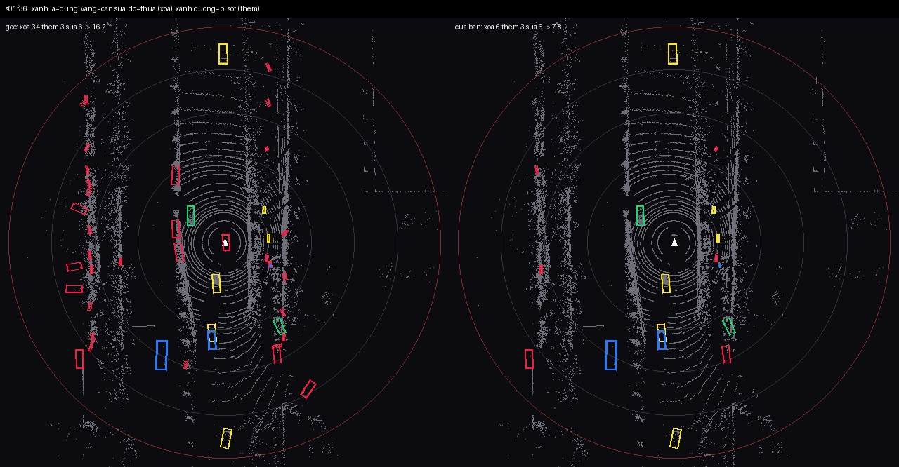

# Báo cáo Day 14 — Lê Văn Trung Tính — 2A202603145

- Mã học viên dùng với `--student`: 2A202603145
- `seed_tag` trong `frames_A.txt`: 393590736f

## 1. Dự đoán trước sweep (bước 5b)

Ghi **trước** khi chạy `scripts/pp_sweep.py`, rồi commit và push ngay (lịch sử commit là bằng chứng thời điểm viết). Không sửa phần này sau khi có kết quả.

- Tham số tôi nghĩ giảm công sửa nhiều nhất: `score_thr` (tăng lên 0.3 - 0.4) kết hợp với `min_points` (tăng lên 5 hoặc 10).
- Vì sao (nhìn ảnh BEV tập A: box thừa nhiều hay box sót nhiều?): Quan sát ảnh BEV và phân bố box tập A (`s01f36`, `s03f56`, `s05f16`), số lượng box thừa (False Positive) chiếm ưu thế lớn, đặc biệt là các box nhỏ lớp `Cyclist` (frame `s01f36` có tới 25 box `Cyclist`) và các box ở cự ly xa ven đường có rất ít điểm phản xạ. Do đó việc tăng `score_thr` để loại bỏ các dự đoán có score thấp và đặt `min_points >= 5` để loại bỏ box rác ít điểm sẽ triệt tiêu được lượng lớn box thừa mà không làm sót thêm nhiều xe thật. Mặt khác, PointPillars KITTI không hỗ trợ nhận diện `Bus` và `Truck` nên các xe lớn bị sót vẫn phải gán thêm thủ công.

## 2. Tập A: sửa tay và tune

| Cấu hình | Xóa | Thêm | Sửa | Chi phí |
|---|---:|---:|---:|---:|
| Gốc (`score_thr=0.1`, `min_points=0`) | 70 | 13 | 25 | 46.5 |
| `best_config.json` | 13 | 21 | 18 | 33.9 |

- Tham số đã đổi trong `best_config.json`: `score_thr` 0.1 → 0.5 (`min_points` giữ 0; ở `score_thr=0.5` cả ba giá trị `min_points` 0, 5, 10 đều ra 33.9).
- Kết quả leave-one-out (dán các dòng `scripts/pp_sweep.py` in ra):
  ```
  s01f36: cấu hình chọn {'score_thr': '0.5', 'min_points': '0'} → 7.8 (tốt nhất có thể 7.8)
  s03f56: cấu hình chọn {'score_thr': '0.5', 'min_points': '0'} → 12.9 (tốt nhất có thể 12.9)
  s05f16: cấu hình chọn {'score_thr': '0.5', 'min_points': '0'} → 13.2 (tốt nhất có thể 12.6)
  ```
- Cấu hình có ổn định trên từng frame không? Vì sao tôi vẫn chọn (hoặc không chọn) nó: Cấu hình `score_thr=0.5, min_points=0` rất ổn định trên từng frame: trong kiểm chứng leave-one-out, cả 3 lần giữ lại 1 frame đều chọn đúng cấu hình này; trên `s01f36` và `s03f56` đạt chi phí tối ưu tuyệt đối (7.8 và 12.9), còn trên `s05f16` đạt 13.2 (chỉ chênh 0.6 điểm so với mức tốt nhất 12.6 ở `score_thr=0.4`). Tôi vẫn chọn cấu hình này vì tổng chi phí thấp nhất (33.9 so với 46.5 của cấu hình gốc) và cho kết quả nhất quán nhất qua leave-one-out.

## 3. Trước/sau (bước 8)



- `scripts/pp_compare.py` báo giảm 27% công sửa trên tập A (46.5 → 33.9 trên 3 frame).
- Dự đoán ở mục 1 đúng hay sai? Giải thích bằng số box xóa/thêm/sửa: Dự đoán ở mục 1 **đúng về xu hướng chính** (tăng `score_thr` giúp giảm mạnh công sửa nhờ triệt tiêu lượng lớn box thừa), chỉ lệch nhẹ ở mức ngưỡng tối ưu (`0.5` tốt hơn mức dự đoán `0.3–0.4`) và vai trò của `min_points`. Cụ thể, khi tăng `score_thr` từ 0.1 lên 0.5: số box cần xóa giảm mạnh từ **70 → 13** (bớt 57 box thừa) và số box cần sửa giảm từ **25 → 18**, trong khi số box phải thêm chỉ tăng từ **13 → 21** (+8 box). Nhờ lợi ích từ việc giảm xóa và sửa vượt trội phần chi phí thêm mới, tổng chi phí giảm từ **46.5 → 33.9** (-27%). Ở `score_thr=0.5`, các box giữ lại đều đã có đủ điểm LiDAR nên `min_points` (0, 5, 10) cho kết quả như nhau.

## 4. Tập B

Số đo từ `scripts/pp_prelabel.py --frames d14_2A202603145/frames_B.txt --config d14_2A202603145/best_config.json --gt d14_2A202603145/ref_B.json`:

| Xóa | Thêm | Sửa | Chi phí |
|---:|---:|---:|---:|
| 4 | 4 | 1 | 5.7 |

(12 frame, GT 160 hộp, khớp 156.)

- Loại box tốn công sửa nhất ở tập B: Các box bị sót phải **thêm mới** (4 box = 4.0/5.7 điểm chi phí, chiếm ~70% tổng công sửa), chủ yếu là xe cỡ lớn thuộc lớp `Bus` (2 box) và `Truck` (1 box) do model PointPillars KITTI không có 2 lớp này, cùng các box bị lọc mất do ngưỡng `score_thr=0.5` cao.

## 5. Giới hạn

- Nêu ít nhất 2 giới hạn (ví dụ: chỉ 3 frame tune; model KITTI không có Truck/Bus; chi phí là công thức, chưa phải thời gian sửa thật):
  1. Tập tune A chỉ có 3 frame nên việc chọn siêu tham số dễ gặp hiện tượng overfitting trên một số bối cảnh cụ thể của sequence.
  2. Model PointPillars huấn luyện trên KITTI chỉ phát hiện 3 lớp (Car, Cyclist, Pedestrian), hoàn toàn không nhận diện được xe tải (Truck) và xe buýt (Bus) vốn xuất hiện nhiều trong giao thông thực tế tại Việt Nam.
  3. Chi phí sửa dựa trên công thức đại diện (trọng số xóa 0.3, thêm 1.0, sửa 0.5) chưa phản ánh chính xác 100% thời gian thao tác tay thực tế của annotator trên giao diện 3D CVAT.
